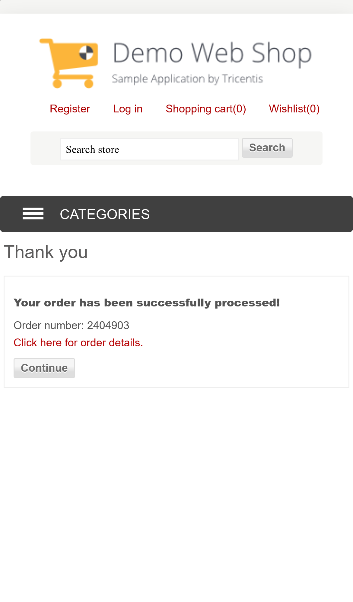

# Example: finding the cause of a failure with a trace and a screenshot

A real failure I had while building this suite, and how I found the fix.

## Symptom

The `@smoke` critical path failed on **mobile-safari** (iPhone 14 emulation,
WebKit) with only:

```
Test timeout of 60000ms exceeded.
```

It passed when I ran it again alone. Firefox had a similar failure once in the same
run. My first idea was "flaky, add a retry", but that would hide the real cause.

## Step 1: the screenshot

`screenshot: 'only-on-failure'` saved the page at the moment the test was
stopped:



The page shows **"Your order has been successfully processed! Order number:
2404903"**. So the shop and the test steps worked. The problem was not the checkout.

## Step 2: the trace

`trace: 'retain-on-failure'` (local) kept `trace.zip`. I opened it with
`npx playwright show-trace <path>` and looked at the step times:

| Step | Duration |
| --- | --- |
| select the product | 2.1 s |
| cart charges the price that was shown | 2.6 s |
| **check out as guest, pay on delivery** | **56.1 s** |
| ↳ navigate to cart / check terms / click Checkout / click "Checkout as Guest" | 5.8 s / 5.2 s / 6.6 s / 9.4 s |
| confirmation + cart emptied | 2.1 s |

Every action worked, but some clicks took 5–9 seconds. The test was correct but
needed more than 60 s, because two browsers ran in parallel on my 7.6 GB laptop
against a public demo server.

## Step 3: choose the fix

| Option | Result |
| --- | --- |
| Add retries | No: hides the slow test, and makes another full order on a shared demo |
| Raise the global timeout | No: then a real hang in any other test takes longer to fail |
| Add `waitForTimeout` | No: makes every run slower and is still a guess |
| **More time for this one long test** | Yes: a full order is about 25 requests. `test.setTimeout(120_000)` only on this test, with a comment that links here |

After this change the smoke test passed on all three browsers.

## What helped

- The failure screenshot showed right away that the app did not break.
- The trace showed the time of each step, so I did not have to guess.
- The `test.step()` names made the trace easy to read ("check out as guest, pay on
  delivery").
- CI uploads the same files (`playwright-report/`, `test-results/`). There I use
  `trace: 'on-first-retry'`, so the trace is from the attempt that failed.

## Screenshot when the test passes

`critical-path.spec.ts` also attaches a screenshot of the confirmation page with
`testInfo.attach('order-<number>-confirmation', …)` **when it passes**. So the report
shows which order number each run created. This helps when someone asks "which test
order is this?" on a shared environment.
